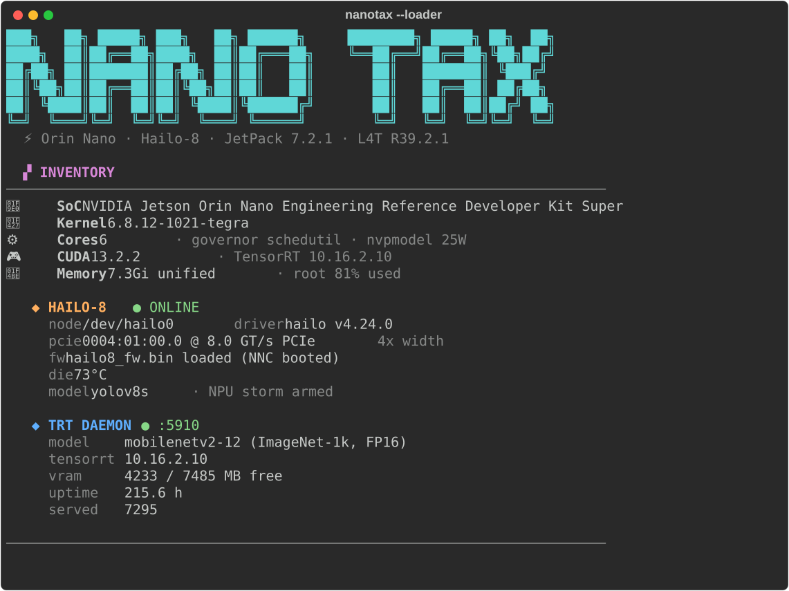
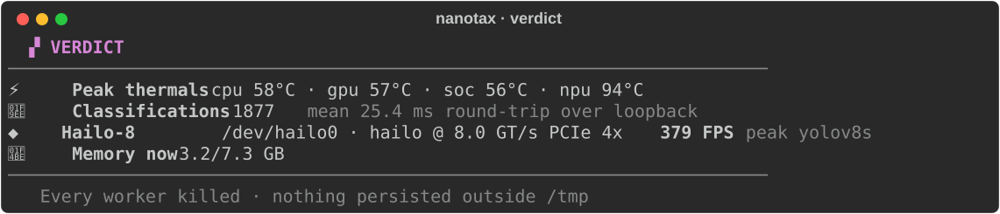
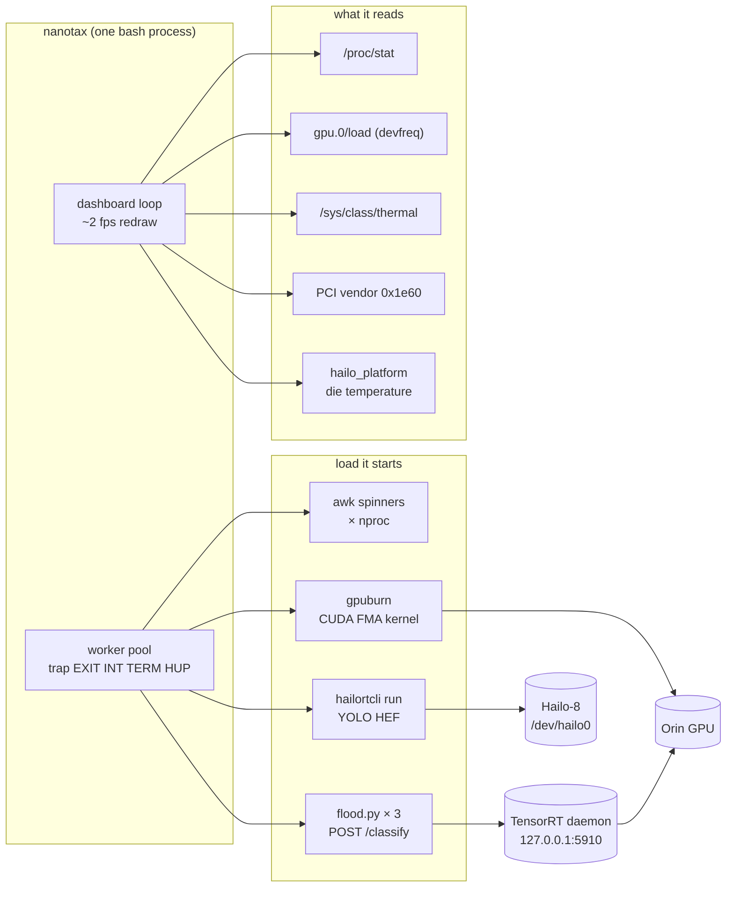

<div align="center">



# NanoTax

**Tax every block of silicon on a Jetson at once, and watch the bill come in live.**

CPU storm, GPU storm, NPU storm, then all three together, on one terminal dashboard that reads the hardware straight from sysfs.

[](https://github.com/steven-matison/NanoTax/actions/workflows/ci.yml)
[](LICENSE)


[](https://developer.nvidia.com/embedded/jetson-orin-nano-developer-kit)


[](https://hailo.ai/products/ai-accelerators/hailo-8-m2-ai-acceleration-module/)


</div>

---

I bolted a Hailo-8 into the M.2 slot of a Jetson Orin Nano and wanted one screen that answers two questions: is every accelerator on this board alive, and what happens to each of them when the others are under load? NanoTax is that screen. It is a single Bash file. It starts its own load, measures, and kills everything it started on the way out.

## Quick start

```bash
curl -fsSL https://raw.githubusercontent.com/steven-matison/NanoTax/main/install.sh | bash
nanotax            # 12 s per phase
```

```bash
nanotax 30         # 30 s per phase
nanotax -y 20      # skip "press enter"
nanotax --loader   # the inventory screen above, then exit
```

Or run it from a clone, no install at all:

```bash
git clone https://github.com/steven-matison/NanoTax && ./NanoTax/nanotax
```

## The dashboard

<div align="center">

<br><sub>A recorded run on the reference box, one frame per phase.</sub>
</div>

Every phase is time-bounded. The meters redraw about twice a second: per-core load from `/proc/stat` deltas, GPU load from the Tegra devfreq node, unified memory, four thermal zones (CPU, GPU, SoC and the NPU die), the inference rate, and the Hailo's live FPS.

| # | Phase | What runs | What it shows you |
|---|---|---|---|
| 1 | 💤 Idle baseline | nothing | the floor every other phase is read against |
| 2 | 🔥 CPU storm | one `awk` FMA spinner per core | thermal headroom with the GPU and NPU idle |
| 3 | 🎮 GPU storm | three clients flooding a resident TensorRT daemon, or the built-in CUDA burner | GPU load and inference latency on their own |
| 4 | ◆ NPU storm | `hailortcli run` on a YOLO HEF | NPU throughput and how fast the die heats |
| 5 | 💥 Full tax | all of the above at once | contention: who slows down when everyone is busy |
| 6 | ❄️ Cooldown | nothing | how fast the board sheds the heat |

<div align="center">

</div>

## How it works



Nothing in the read path needs root. The Hailo is found by scanning the PCI bus for vendor `0x1e60`, so the slot address is never hard-coded. Its link speed, width, driver binding and MSI count come from sysfs; its architecture comes from `hailortcli fw-control identify` when that is on the box; its die temperature comes from `pyhailort` when a Python with `hailo_platform` is found.

## Measured on the reference box

Jetson Orin Nano Developer Kit Super at 25 W, JetPack 7.2.1, a Hailo-8 M.2 M-key module (extended temperature) in the 2280 slot, HailoRT 4.24.0, precompiled HEFs from the Hailo Model Zoo v2.20.0.

**Hailo-8 throughput**, `hailortcli run`, batch 1, five seconds per model with a 60 s cooldown between them:

| Model | FPS | Die before | Die after 5 s |
|---|---:|---:|---:|
| YOLOv8n | 397 | 80.5 °C | 84.4 °C |
| YOLOv8s | 379 | 80.9 °C | 91.6 °C |
| YOLOv11s | 52 | 83.9 °C | 85.0 °C |
| MobileNetV2 1.0 | 2595 | 81.4 °C | 86.0 °C |

`hailortcli benchmark` on YOLOv8n reports 398 FPS, 2.93 ms hardware latency and 2.95 W average module power. YOLOv11s is a multi-context network, so at batch 1 it pays a context switch per frame.

**Contention.** On its own the NPU holds 397 FPS on YOLOv8n and 379 on YOLOv8s. In the full-tax phase, with all six CPU cores pegged by the storm, those drop to 222 and 279. The Hailo is not the bottleneck there: `hailortcli` feeds it frames from the host, and the host is busy. The TensorRT daemon on the GPU barely moves across the same phases, holding about 26 ms mean round-trip with three concurrent clients.

### The bare Hailo-8 module needs a heatsink

With the case closed, the module idles at 80 to 88 °C in this slot with nothing running, and a full NanoTax run peaks it at 94 °C. Under sustained load the firmware steps its clock down and then refuses new work. From `hailort.log`:

```text
HEF was compiled assuming clock rate of 400 MHz, while the device clock rate is 300 MHz.
Got health monitor notification - System's clock has been changed from 300000000 to 250000000
Got health monitor notification - System's clock has been changed from 250000000 to 200000000
Aborting Infer, Device 0004:01:00.0 got closed streams notification from 'Health Monitor'
Firmware major status: CONTEXT_SWITCH_STATUS_HIGH_TEMPERATURE_WHEN_OPENING_STREAM
```

So NanoTax shows the NPU die temperature next to the SoC zones, and the numbers above come from short runs with a cooldown between them. If your FPS falls off a cliff partway through a run, read the `npu` reading on the TEMP row before blaming anything else. Taking the side covers off doubles the rate it sheds heat (about 7 °C a minute instead of 3.5), but it still idles in the 70s. A thermal pad and an M.2 heatsink on the module are the fix.

## Configuration

Everything is optional. With no configuration NanoTax finds what it can and skips what it can't, with a line saying so.

| Variable | Default | What it does |
|---|---|---|
| `NANOTAX_INFER_URL` | `http://127.0.0.1:5910` | a resident classifier to flood in the GPU phase |
| `NANOTAX_IMAGE` | none | the JPEG the flood clients POST |
| `NANOTAX_GPU` | `auto` | `infer`, `burn`, `off`, or `auto` (daemon if healthy, else the CUDA burner) |
| `NANOTAX_HEF` | first YOLO HEF in `~/hailo/models`, then `/usr/share/hailo-models` | the model for the NPU storm |
| `NANOTAX_HAILORTCLI` | `hailortcli` on `PATH` | a `hailortcli` built somewhere else |
| `NANOTAX_HAILO_PY` | `python3`, then `~/hailo-infer/venv/bin/python` | a Python with `hailo_platform`, for the die temperature |
| `NANOTAX_COLOR` | `auto` | `always` or `never` |

### The inference daemon contract

The GPU phase talks to any HTTP service with this shape, so a TensorRT engine, ONNX Runtime or anything else can sit behind it:

```text
POST /classify    body: raw JPEG bytes     → any 2xx
GET  /health      → JSON; these keys are shown when present:
                    model, tensorrt, device_memory_free_mb,
                    device_memory_total_mb, uptime_s, requests_served
```

With no daemon running, NanoTax compiles a 20-line CUDA kernel once with `nvcc` into `~/.cache/nanotax/gpuburn` and uses that to hold the GPU instead.

## The NPU phase

NanoTax does not install anything on the Hailo side. Phase 4 runs when three things are already on the box: the `hailo_pci` driver with `/dev/hailo0` up, a `hailortcli`, and a compiled HEF. The die temperature on the TEMP row also needs a Python with `hailo_platform`. Those come from Hailo's own public projects: [hailort-drivers](https://github.com/hailo-ai/hailort-drivers), [hailort](https://github.com/hailo-ai/hailort) and the [Hailo Model Zoo](https://github.com/hailo-ai/hailo_model_zoo). Point NanoTax at a `hailortcli` built outside `PATH`:

```bash
NANOTAX_HAILORTCLI=~/hailo/hailort/build/hailort/hailortcli/hailortcli nanotax
```

Without them the inventory says which piece is missing and phase 4 is skipped.

## What it promises

- **Every worker dies with it.** One `trap` on `EXIT INT TERM HUP` kills the pool, so Ctrl-C mid-storm leaves nothing behind.
- **No sudo, no installs, no restarts.** It reads sysfs and starts its own processes. That's all.
- **Nothing written outside a `mktemp -d`**, except the optional CUDA burner binary in `~/.cache/nanotax`.
- **It degrades instead of failing.** No Hailo, no CUDA, no daemon, not even a Jetson: each panel says what it couldn't find and the run goes on. CI runs it on plain x86_64 and arm64 runners to keep that true.

## Rendering the README art

The images in this README are real runs, rendered from a terminal recording:

```bash
script -qfec "stty cols 82 rows 40; ./nanotax -y 8" session.typescript
python3 tools/ansi2svg.py loader    session.typescript docs/assets/loader.svg
python3 tools/ansi2svg.py dashboard session.typescript docs/assets/dashboard.svg
python3 tools/ansi2svg.py verdict   session.typescript docs/assets/verdict.svg
```

`dashboard` stitches one frame per phase into a single SVG that cycles with pure CSS, so it animates inside GitHub without a GIF. It needs `pip install rich`.

## License

[Apache License 2.0](LICENSE)
